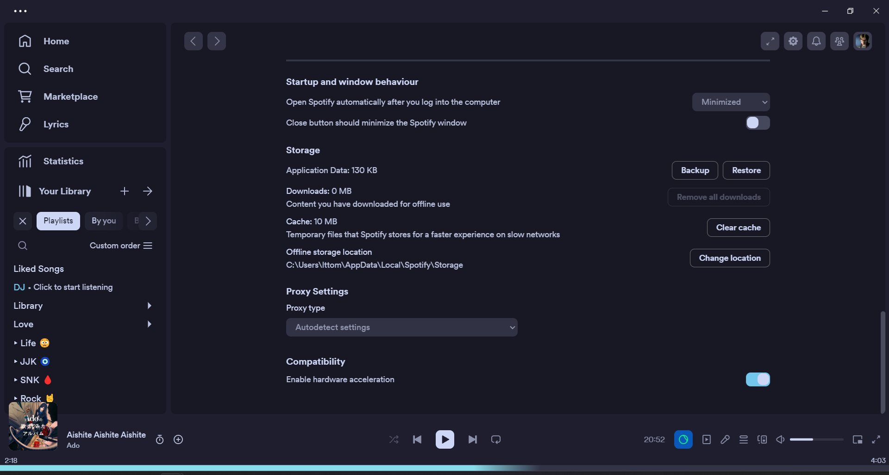
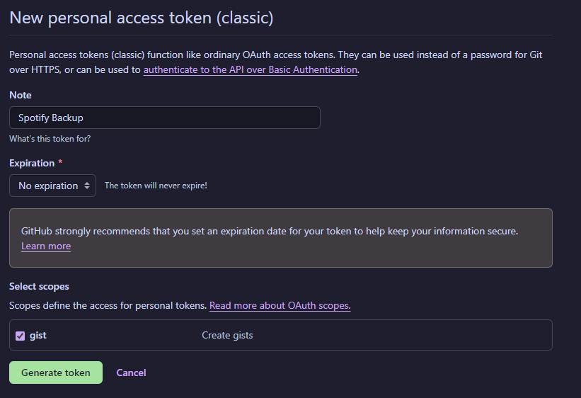
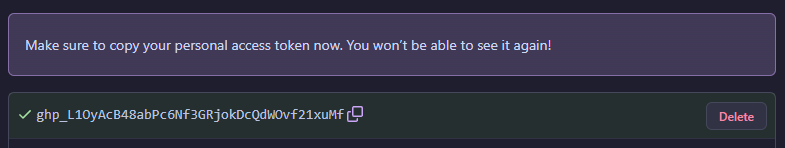
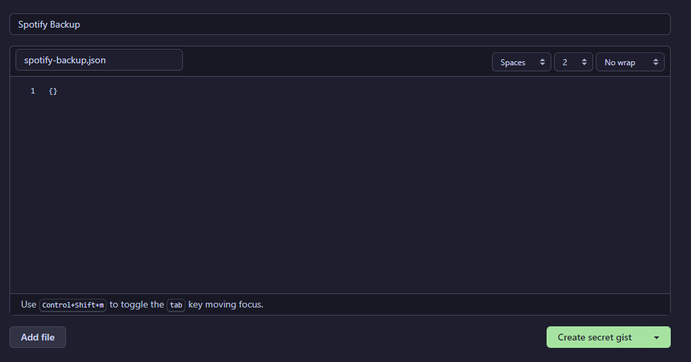
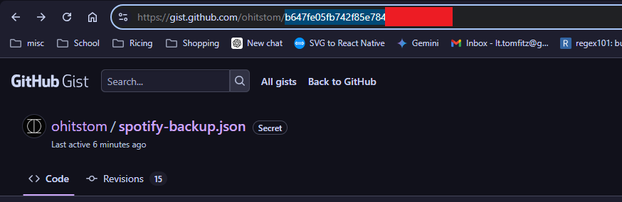

# spotifyBackup.js

_This script allows you to backup / restore application data (settings)._

### Installation

1. Install [Spicetify](https://spicetify.app) and set it up according to the instructions.
2. Navigate to your Spicetify config directory via the command `spicetify config-dir`.
3. Download spotifyBackup.js and place it in `/extensions`.
4. Run `spicetify config extensions spotifyBackup.js` and `Spicetify apply` in terminal.

### Usage

Navigate to Spotify settings, scroll to "Storage", backup your settings to clipboard - and import them on your secondary device.

Marketplace settings and installations are included using Marketplace's existing export function, whether its running version uses localStorage or IndexedDB. The backup remains a flat JSON object with the original `marketplace:*` keys and string values; historical backups and Gists use the same format.

An empty Marketplace export is saved with `marketplace:installed-extensions` set to `"[]"`, so restoring a newly created empty snapshot clears installations instead of treating it as a historical omission. Ordinary-settings-only historical restores do not wait for Marketplace initialization.

When a backup contains Marketplace keys, restore replaces them in an existing `spicetify-marketplace` IndexedDB database, preserving internal database metadata. Modern Marketplace reads those records directly; legacy Marketplace also receives the records in localStorage. Restore does not create or upgrade a Marketplace database. Historical backups that omitted Marketplace data leave the existing database untouched; localStorage is still replaced as before.

If Marketplace is configured but has not initialized, backup and restore wait for its export function instead of proceeding with incomplete data. Keep the Marketplace companion extension enabled; if initialization fails, the operation remains pending until Spotify is restarted. An obsolete database left by a newer version does not override the running legacy Marketplace's export. This does not change Marketplace's own upgrade/downgrade migration behavior outside backup and restore.

Spotify Backup's Gist configuration stays local to the device during restore. If a localStorage write fails (for example, because the backup exceeds its quota), restore aborts the Marketplace transaction and attempts to recover the previous local settings. The two storage systems do not share an atomic transaction; recovery cannot be guaranteed if storage itself remains unavailable or Spotify exits during restore.

Restore while Marketplace is idle, not while installing or changing settings. For modern Marketplace, restore aborts if its exported state changes or differs from the stored records, rather than reporting success over pending writes. Marketplace does not expose a public persistence-queue lock; this check cannot prevent changes initiated after the check.

If modern Marketplace's stable export matches its localStorage records instead of its database, restore also writes localStorage for that fallback session. Matching records are evidence of the source, not a persistence-queue lock; keep Marketplace idle during restore.

#### Gist Integration Setup
This extension also allows the user to automatically backup and restore to a GitHub Gist.
Please note that Gist has a limited file upload of 1MB. If your application data exceeds this value please manually backup and restore your data.

##### Github Token
There should be no security issues with storing your GitHub access token in local storage assuming you setup permissions to the token correctly, however if you want to be on the safe side make a throw away GitHub account.

1. Head over to https://github.com/settings/tokens
2. Generate a new **classic** token:

3. Copy the token:

##### Gist ID
1. Head over to https://gist.github.com/
2. Create a secret Gist like so:

3. Copy the ID from the search bar:

### Compatibility

Relies on platform methods, and css map / dom structure.

### Regression tests

Run `python3 -m http.server 8765 --bind 127.0.0.1` from the repository root and open `http://127.0.0.1:8765/spotifyBackup/spotifyBackup.test.html` in a disposable browser profile. The tests use native IndexedDB and localStorage with simulated Spicetify, clipboard, and Gist APIs; they clear the test origin's storage. They do not exercise Spotify itself or contact GitHub.
